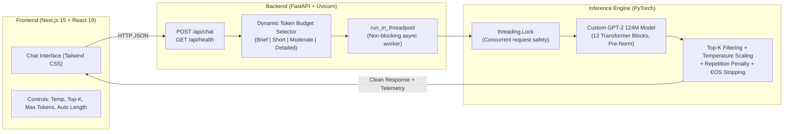

# Custom GPT-2 124M Chat Application

A full-stack, ChatGPT-style web application built from scratch with **PyTorch**, **FastAPI**, **Next.js**, and **Tailwind CSS**. All responses are generated entirely locally by a custom **124M parameter GPT-2** model with instruction fine-tuning, dynamic token budgets, and thread-safe GPU inference—**no external LLM APIs (OpenAI, Gemini, Anthropic) are used**.

---

## Table of Contents
- [Quick Start (TL;DR)](#-quick-start-tldr)
- [Architecture Overview](#architecture-overview)
- [Key Features](#key-features)
- [Tech Stack](#tech-stack)
- [Project Directory Structure](#project-directory-structure)
- [Prerequisites](#prerequisites)
- [Installation & Setup](#installation--setup)
- [Model Training (Instruction Fine-Tuning)](#model-training-instruction-fine-tuning)
- [Running the Application](#running-the-application)
- [API Documentation](#api-documentation)
- [Running Tests](#running-tests)
- [Technical Architecture Breakdown](#technical-architecture-breakdown)
- [Troubleshooting & Windows Notes](#troubleshooting--windows-notes)

---

## ⚡ Quick Start (TL;DR)

If you already have the repository and virtual environment set up, here are the exact commands to train and launch everything:

### 1. Retrain / Fine-Tune Model on GPU
```powershell
.\.venv\Scripts\python.exe -m training.train_instruction --epochs 3 --batch-size 1 --grad-accum 8
```

### 2. Start FastAPI Backend (GPU Inference)
```powershell
.\.venv\Scripts\python.exe -m uvicorn backend.main:app --host 0.0.0.0 --port 8000
```

### 3. Start Next.js Frontend (in a second terminal)
```powershell
cd frontend
$env:Path = "C:\Program Files\nodejs;" + $env:Path
npm.cmd run dev
```
Open **[http://localhost:3000](http://localhost:3000)** in your browser!

---

## Architecture Overview



---

## Key Features

1. **Custom PyTorch GPT-2 Architecture (`model/gpt.py`)**:
   - Reuses custom implementations of `Normalize` (LayerNorm), `GELU`, `FeedForward`, `MultiHeadAttention` (with causal masking), `TransformerBlock`, and `GPTModel`.
   - Native support for CUDA GPU inference and training with strict GPU verification (`require_gpu=True`).
2. **Instruction Fine-Tuning Pipeline (`training/`)**:
   - Upgraded raw text-autocomplete GPT-2 into an instruction-following assistant.
   - **Response-Only Loss Masking (`-100`)**: Prompts and extra padding tokens are masked out during loss calculation so the model is penalized exclusively on response generation and natural `<|endoftext|>` stopping.
   - **Variable-Length Examples**: Curated instruction dataset teaching brief, moderate, and detailed step-by-step responses.
3. **Dynamic Response Length (`backend/token_budget.py`)**:
   - Dynamically analyzes prompts to allocate an optimal token ceiling (`brief` ≤ 72 tokens, `short` ≤ 96 tokens, `moderate` ≤ 160 tokens, `detailed` ≤ 384 tokens).
   - `max_new_tokens` acts as an upper limit; the model stops naturally whenever it produces `<|endoftext|>`.
4. **Thread-Safe, High-Performance FastAPI Backend (`backend/`)**:
   - Loads model checkpoint once into GPU VRAM on startup via lifespan hooks.
   - Synchronous GPU inference is executed in a thread pool behind a thread lock to ensure concurrent requests never conflict.
   - Full CORS configuration and comprehensive error handling.
5. **Modern ChatGPT-Style Frontend (`frontend/`)**:
   - Clean dark-mode interface built with Next.js, React, TypeScript, and Tailwind CSS.
   - Message bubbles with generation metadata (tokens used, generation time, stop reason, length category).
   - Real-time generation settings (temperature, Top-K, max tokens ceiling, dynamic budget toggle).
   - Live backend health status, copy button, auto-scrolling, and conversation reset.

---

## Tech Stack

| Component | Technologies |
| :--- | :--- |
| **Model** | PyTorch, tiktoken, custom GPT-2 124M architecture |
| **Backend** | Python 3.12, FastAPI, Uvicorn, Pydantic v2 |
| **Frontend** | Next.js 15, React 19, TypeScript, Tailwind CSS, Lucide Icons |
| **Dataset** | Alpaca-style instruction JSON + length-diverse curated datasets |
| **Testing** | Pytest, HTTPX, ASGI Test Client |

---

## Project Directory Structure

```text
├── backend/
│   ├── config.py              # Environment paths, CORS origins, and checkpoint locations
│   ├── main.py                # FastAPI app, lifespan startup loading, /api/chat & /api/health
│   ├── schemas.py             # Pydantic models for chat requests and responses
│   └── token_budget.py        # Rule-based dynamic token budget selection
├── checkpoints/
│   ├── .gitkeep               # Directory tracked in Git (checkpoints ignored via .gitignore)
│   ├── gpt2_pretrained_124m.pth   # Converted PyTorch base weights (124M)
│   └── gpt2_instruct_124m.pth     # GPU fine-tuned instruction model checkpoint
├── data/
│   ├── instruction-data.json         # Base 1,100 instruction pairs
│   └── length_aware_instructions.json # Additional brief/detailed length training examples
├── frontend/                  # Next.js 15 frontend application
│   ├── src/
│   │   ├── app/               # Next.js App Router (page.tsx, layout.tsx, globals.css)
│   │   ├── components/        # ChatInterface, MessageBubble, SettingsPanel, TypingIndicator
│   │   └── lib/               # api.ts (HTTP client for FastAPI backend)
│   ├── package.json
│   ├── tailwind.config.ts
│   └── tsconfig.json
├── gpt2/
│   └── 124M/                  # Raw OpenAI TensorFlow weights (encoder, hparams, checkpoint)
├── inference/
│   └── engine.py              # Thread-safe GPT2InferenceEngine with GPU locking
├── model/
│   ├── checkpoint.py          # Weight conversion from TF to PyTorch, save/load checkpoint
│   ├── generation.py          # Top-K, temperature, repetition penalty, and EOS stopping
│   └── gpt.py                 # Custom GPT-2 model architecture (from GPT.ipynb)
├── training/
│   ├── dataset.py             # InstructionDataset & custom_collate_fn (response-only loss masking)
│   ├── prepare_data.py        # Train / validation / test splits
│   └── train_instruction.py   # Standalone GPU instruction fine-tuning training script
├── tests/
│   ├── test_api.py            # Unit & concurrency tests for FastAPI endpoints
│   ├── test_model_and_masking.py # Unit tests for model forward pass, masking, and generation
│   └── test_token_budget.py   # Unit tests for dynamic length budget classification
├── .gitignore
├── requirements.txt
└── README.md
```

---

## Prerequisites

- **OS**: Windows 10/11, Linux, or macOS.
- **Python**: Version `3.10` to `3.12`.
- **Node.js**: Version `18.x` or later (LTS recommended).
- **GPU (Recommended)**: NVIDIA GPU with CUDA support (e.g. GTX 1650, RTX series). CPU execution is supported as fallback.

---

## Installation & Setup

### 1. Clone & Set Up Python Environment

```powershell
# Navigate to the project root
cd "d:\LLM\LLM Project"

# Create a virtual environment
python -m venv .venv

# Activate virtual environment
# Windows PowerShell:
.\.venv\Scripts\Activate.ps1
# Windows Command Prompt:
.\.venv\Scripts\activate.bat
# Linux / macOS:
source .venv/bin/activate
```

### 2. Install PyTorch & Dependencies

For CUDA acceleration (replace `cu124` with your CUDA version if different):
```powershell
pip install torch --index-url https://download.pytorch.org/whl/cu124
pip install -r requirements.txt
```

*(Note for Windows users: `requirements.txt` includes `msvc-runtime` to ensure all required Visual C++ runtime DLLs are present for PyTorch and CUDA without requiring a separate system-wide installer).*

### 3. Install Frontend Dependencies

```powershell
cd frontend
npm.cmd install
cd ..
```

---

## Model Training (Instruction Fine-Tuning)

The project separates **training** from **inference**. You do not need to retrain every time the application starts.

### Running Instruction Fine-Tuning on GPU

To train on your GPU using response-only loss masking and gradient accumulation:

```powershell
# Direct virtual environment path:
.\.venv\Scripts\python.exe -m training.train_instruction --epochs 3 --batch-size 1 --grad-accum 8

# Or with activated venv:
python -m training.train_instruction --epochs 3 --batch-size 1 --grad-accum 8
```

### What This Does:
1. Automatically loads the base weights from `gpt2/124M/` and converts them into `checkpoints/gpt2_pretrained_124m.pth` if not already present.
2. Loads training pairs from `data/instruction-data.json` and `data/length_aware_instructions.json`.
3. Applies response-only masking (`-100` on prompt tokens and excess padding).
4. Trains on GPU using `AdamW` (`lr=5e-5`), Cosine Annealing scheduler, and gradient clipping.
5. Evaluates validation loss periodically and saves the best checkpoint to:
   `checkpoints/gpt2_instruct_124m.pth`.

---

## Running the Application

### 1. Start the FastAPI Backend

From the project root:

```powershell
# Windows PowerShell (direct venv path):
.\.venv\Scripts\python.exe -m uvicorn backend.main:app --host 0.0.0.0 --port 8000

# Or with activated venv:
uvicorn backend.main:app --host 0.0.0.0 --port 8000
```

When started, the backend will log:
```text
INFO: Loading GPT-2 model onto device=cuda ...
INFO: Loaded GPT-2 (instruction-finetuned) from D:\LLM\LLM Project\checkpoints\gpt2_instruct_124m.pth
INFO: Application startup complete.
INFO: Uvicorn running on http://0.0.0.0:8000
```

Verify backend health in another terminal:
```powershell
curl http://127.0.0.1:8000/api/health
```

### 2. Start the Next.js Frontend

In a separate terminal:

```powershell
cd frontend
# If npm is not in your current PowerShell session's PATH on Windows:
$env:Path = "C:\Program Files\nodejs;" + $env:Path
npm.cmd run dev

# Or in any terminal where npm is in PATH:
npm run dev
```

Open your browser at:
👉 **[http://localhost:3000](http://localhost:3000)**

---

## API Documentation

The FastAPI backend automatically provides interactive OpenAPI documentation at `http://localhost:8000/docs`.

### 1. `GET /api/health`
Check server readiness and active model metadata.

**Response (200 OK):**
```json
{
  "status": "ok",
  "model_loaded": true,
  "model_variant": "instruction-finetuned",
  "device": "cuda",
  "context_length": 1024,
  "checkpoint_path": "D:\\LLM\\LLM Project\\checkpoints\\gpt2_instruct_124m.pth",
  "error": null
}
```

### 2. `POST /api/chat`
Generate autoregressive responses from the model.

**Request Body:**
```json
{
  "message": "Explain briefly what an API is.",
  "history": [
    {"role": "user", "content": "Hello!"},
    {"role": "assistant", "content": "Hi there! How can I help you today?"}
  ],
  "temperature": 0.7,
  "top_k": 40,
  "max_tokens": 256,
  "auto_length": true
}
```

**Response (200 OK):**
```json
{
  "response": "An API (Application Programming Interface) is a set of rules that lets different software applications communicate with each other using standard protocols.",
  "model_variant": "instruction-finetuned",
  "device": "cuda",
  "tokens_generated": 32,
  "token_budget": 72,
  "length_category": "brief",
  "stopped_reason": "eos",
  "generation_time_ms": 782.4
}
```

---

## Running Tests

The test suite covers model architecture, loss masking, generation controls, dynamic token budgeting, and API concurrency:

```powershell
# Run all unit and API tests
pytest -v

# Run specific test modules
pytest tests/test_model_and_masking.py -v
pytest tests/test_token_budget.py -v
pytest tests/test_api.py -v
```

---

## Technical Architecture Breakdown

### 1. Why Response-Only Loss Masking Matters
Standard causal language models train on all tokens. For an instruction-tuned model, we do not want the model to spend gradient updates learning the instruction template (`"Below is an instruction that describes a task..."`).

In `training/dataset.py`, `custom_collate_fn` assigns target IDs as follows:
- **Prompt tokens**: Replaced with `-100`. In PyTorch, `F.cross_entropy(..., ignore_index=-100)` ignores these positions completely, producing zero loss and zero gradient.
- **Response tokens**: Kept as true token IDs. 100% of the training loss optimizes response quality.
- **EOS token (`<|endoftext|>`)**: Kept as `50256` so the model explicitly learns when to stop.
- **Subsequent padding tokens**: Replaced with `-100` so batch padding does not distort gradients.

### 2. Dynamic Token Budgeting
Instead of a fixed hard token limit for all prompts:
- Questions with keywords like *"briefly"*, *"in short"*, *"summarize"* are capped at `72 tokens`.
- Direct factual questions (*"what is"*, *"convert"*, *"who is"*) are allocated `96 tokens`.
- Open general questions receive `160 tokens`.
- Detailed requests (*"step by step"*, *"in detail"*) are given up to `384 tokens`.
- In all cases, text generation terminates as soon as `<|endoftext|>` is predicted.

### 3. Thread-Safe Inference
PyTorch tensor operations on a single GPU model instance are not safe for simultaneous multi-threaded mutation. In `inference/engine.py`, generation calls are guarded by a Python `threading.Lock`. Concurrent requests from multiple users or tabs queue cleanly without memory corruption.

---

## Troubleshooting & Windows Notes

- **Node / npm not recognized in PowerShell**:
  Run `$env:Path = "C:\Program Files\nodejs;" + $env:Path` in your terminal session or use `npm.cmd`.
- **PowerShell Script Execution Policy**:
  If PowerShell blocks `.ps1` activation scripts, use:
  `Set-ExecutionPolicy -ExecutionPolicy RemoteSigned -Scope CurrentUser`
- **Missing VC++ Runtime DLLs on Windows**:
  The project includes `msvc-runtime` in `requirements.txt` and automatically registers its `Scripts` directory via `os.add_dll_directory` in `model/__init__.py`.
- **GPU Out of Memory (OOM)**:
  For 4 GB cards (such as the GTX 1650), training is configured with `batch_size=1` and `grad_accum=8` (virtual batch size 8). If running with heavier backgrounds, close other GPU-intensive applications.

---

## License

This project is licensed under the MIT License.
